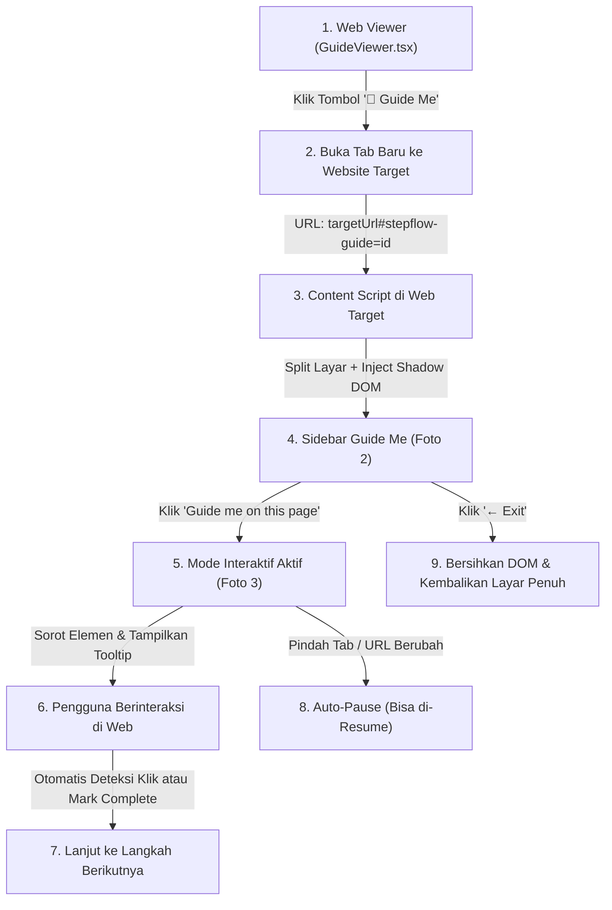

# 📋 Rencana Implementasi Final: Fitur "Guide Me" (Interactive Live Walkthrough)

Dokumen ini berisi rencana teknis dan arsitektur final untuk mengimplementasikan fitur **Guide Me** interaktif di StepFlow, sesuai dengan alur pada Foto 1, Foto 2, dan Foto 3, beserta 3 klarifikasi spesifik dari Anda.

---

## 🎯 3 Fokus Utama Klarifikasi Anda

1. **Tombol Exit Bersih di Sidebar:**
   - Menyediakan tombol `← Exit` yang jelas di bagian atas sidebar.
   - Saat diklik, sidebar ditutup seketika dan lebar layar website target langsung kembali normal 100% (`margin-right` di-reset bersih tanpa meninggalkan sisa style atau script).
2. **Sinkronisasi Judul Kustom (Bebas Diedit Tanpa Error):**
   - Teks pada *floating tooltip* selalu mengambil dari `step.title` terkini yang dibuat/diedit oleh tim (misal diubah dari *"Click on Attendance Management"* menjadi *"Push on XYZ"*).
   - Mesin pencari elemen (*Element Finder*) tidak akan error atau rusak meskipun teks judul diganti total, karena pencarian elemen menggunakan selektor teknis berlapis (`selector`, `id`, `className`, `attributes`, dan koordinat `rect`), bukan teks instruksi.
3. **Smart Auto-Pause & Resume:**
   - Jika pengguna berpindah tab atau berpindah halaman (*navigation change*), sesi panduan akan otomatis masuk ke status **`paused`** demi mencegah penunjuk salah tempat.
   - Saat pengguna kembali ke halaman yang sesuai, sidebar akan menampilkan notifikasi: *"Panduan Dijeda"* dengan tombol **`▶ Lanjutkan (Resume)`** untuk melanjutkan penuntunan.
   - Pengguna juga dapat menekan tombol **`⏸ Pause`** manual kapan saja di bagian bawah sidebar.

---

## 🏗️ Arsitektur & Alur Kerja Sistem



---

## 🛠️ Rincian File yang Akan Dibuat dan Diubah

### 1. Halaman Web Panduan (`web/src/app/guide/[id]/GuideViewer.tsx`)
- **Tampilan Baru:** Mengubah baris teks biasa `Website target: https://...` menjadi tombol utama yang mencolok:
  - Tombol **`🧭 Guide Me (Pandu Saya)`** dengan styling modern (gradasi ungu/oranye, ikon kompas, dan efek hover responsif).
  - Di bawah tombol tetap disertakan tautan website target sebagai referensi.
- **Logika:**
  - Saat tombol diklik, sistem membuka website tujuan di tab baru dengan menyisipkan hash identitas panduan:
    ```
    ${workflow.targetUrl}#stepflow-guide=${workflow.id}
    ```
  - Menyinkronkan data panduan lengkap ke ekstensi agar dapat langsung dieksekusi tanpa perlu query ulang yang lambat.

---

### 2. Komponen Sidebar Panduan Baru (`extension/src/content/GuideMeSidebar.tsx`)
Komponen baru yang akan berjalan di dalam Shadow DOM terisolasi di sisi kanan layar (lebar 380px):

* **Kondisi A: Pra-Panduan (Sesuai Foto 2)**
  - Header: Tombol **`← Exit`**, Judul Panduan (misal: *"Upload Attendance"*), dan badge total langkah (misal: `4 langkah`).
  - Tombol Utama Besar: **`Guide me on this page ➔`** (warna ungu/oranye mencolok).
  - Daftar langkah preview lengkap dengan thumbnail visual dan judul instruksinya.

* **Kondisi B: Mode Panduan Berjalan (Sesuai Foto 3)**
  - Header tetap menampilkan tombol `← Exit` dan indikator langkah aktif (Langkah X dari Y).
  - Kartu Instruksi Aktif: Menampilkan teks instruksi dari `step.title` (dinamis) serta pesan *"It's your move! Complete the action to keep moving forward."*
  - Tombol **`✓ Mark as complete`**: Memungkinkan pengguna melompat ke langkah berikutnya secara manual jika aksi sudah selesai dilakukan.
  - Pratinjau langkah berikutnya (misal: `○ Click on Dashboard`).
  - Tombol Bawah: **`⏸ Pause`** (atau **`▶ Resume`** saat status dijeda).

---

### 3. Logika Penunjuk Langsung di Halaman Web Target (`extension/src/content/index.tsx`)
Ketika mode panduan aktif, script ini bertugas menuntun pengguna di layar kiri:

1. **Smart Element Locator (Pencari Elemen Anti-Error):**
   - **Tingkat 1:** Mencari berdasarkan `step.targetElement.selector` (misal: `#attendance-btn`).
   - **Tingkat 2:** Mencari berdasarkan ID atau `aria-label` / `placeholder`.
   - **Tingkat 3:** Mencari berdasarkan posisi koordinat asli saat perekaman (`rect.x`, `rect.y`, `rect.width`, `rect.height`).
   - *Keunggulan:* Perubahan teks judul oleh tim menjadi *"Push on XYZ"* sama sekali tidak akan mengganggu penemuan elemen.

2. **Visual Spotlight & Floating Badge:**
   - **Glowing Border:** Memberikan outline oranye tebal beranimasi di sekeliling elemen target (`outline: 3px solid #FF5C35; box-shadow: 0 0 16px rgba(255, 92, 53, 0.6)`).
   - **Floating Tooltip Badge:** Kotak hitam melayang dengan ikon pengguna dan teks dinamis:
     ```
     👤 [Judul Langkah Hasil Edit Tim]
     ```
   - Posisi badge otomatis menyesuaikan (di atas, di bawah, atau di samping elemen) agar tidak keluar dari viewport browser.

3. **Deteksi Klik Otomatis & Auto-Advance:**
   - Memasang listener klik sementara pada elemen yang sedang disorot.
   - Ketika pengguna mengklik elemen tersebut, sistem menampilkan animasi centang hijau singkat, lalu otomatis berpindah menyorot langkah selanjutnya.

4. **Sistem Auto-Pause Saat Pindah Tab / Pindah URL:**
   - Mendengarkan event `visibilitychange` dan `popstate` / URL hash change.
   - Jika pengguna berganti tab atau halaman web berpindah ke URL yang berbeda:
     - Efek sorot dan badge disembunyikan sementara.
     - Status berubah menjadi `paused`.
   - Ketika tab kembali aktif atau pengguna kembali ke halaman yang benar, sidebar menampilkan banner notifikasi: *"Panduan Dijeda. Klik Lanjutkan saat Anda siap"* dengan tombol **`▶ Lanjutkan (Resume)`**.

5. **Fungsi Exit Bersih:**
   - Saat `← Exit` ditekan:
     - Seluruh elemen sorot, tooltip, dan event listener dilepas.
     - Sidebar Shadow DOM dicopot dari body.
     - Style `margin-right` pada halaman web dikembalikan ke `0` sehingga tampilan website target kembali normal 100%.

---

## 📌 Checklist Rencana Eksekusi (Setelah Anda Menyetujui)

- [ ] **Langkah 1:** Tambahkan tombol `🧭 Guide Me` pada header [`GuideViewer.tsx`](file:///c:/laragon/www/Record/web/src/app/guide/[id]/GuideViewer.tsx).
- [ ] **Langkah 2:** Buat file komponen sidebar [`extension/src/content/GuideMeSidebar.tsx`](file:///c:/laragon/www/Record/extension/src/content/GuideMeSidebar.tsx).
- [ ] **Langkah 3:** Implementasikan Smart Element Locator, Spotlight Box, Floating Badge, Auto-Pause listener, dan Clean Exit di [`extension/src/content/index.tsx`](file:///c:/laragon/www/Record/extension/src/content/index.tsx).
- [ ] **Langkah 4:** Build ekstensi (`node scripts/build.mjs`), perbarui `stepflow-extension.zip`.
- [ ] **Langkah 5:** Build web app (`npm run build`), verifikasi tidak ada error, lalu push ke GitHub.

